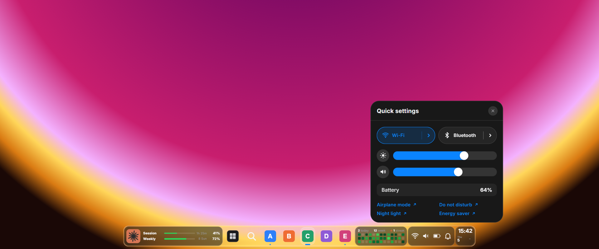
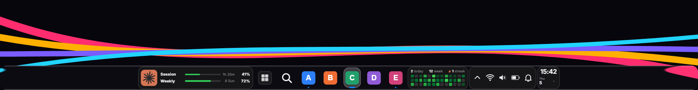
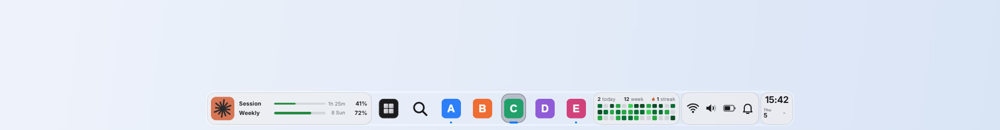
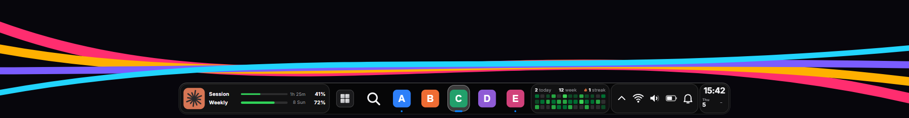
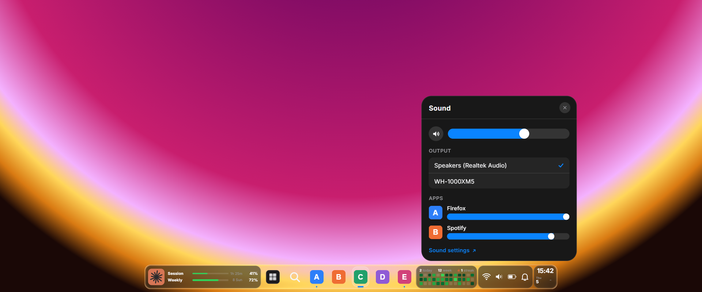
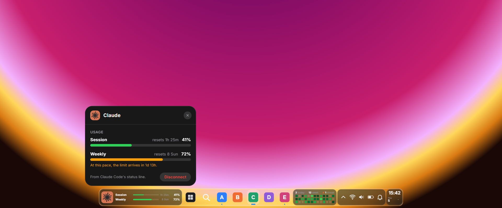

<div align="center">


# Shelf

**A glass widget dock that replaces the Windows taskbar. An open-source alternative to [Lumabar](https://lumabar.xyz).**

Your apps, your system controls and the things you'd otherwise open an app to check, in one centred pill. Free, forever.

[](#requirements)
[](https://tauri.app)
[](https://www.rust-lang.org)
[](https://react.dev)
[](LICENSE)
[](#)

<br />



</div>

---

> [!WARNING]
> **Shelf is a work in progress.** It runs as a daily driver for its author, but there's no installer or release yet, some widgets and settings are still missing, and things may change or break between commits. Bug reports and ideas are very welcome.

## Why Shelf

[Lumabar](https://lumabar.xyz) showed how good a Windows dock can be: live widgets, real glass, a taskbar that finally tells you things. It's also a paid, closed app with a licence key per PC.

A taskbar is basic infrastructure. Everyone has one, all day, and nobody should have to buy back a nicer version of it. Shelf takes the same idea and makes it free and open: no licence, no account, no telemetry, and code anyone can read, fix and extend. If you want a widget that doesn't exist yet, you can [write it](#writing-a-widget) in one file.

> [!IMPORTANT]
> Shelf is an independent project. It isn't affiliated with, endorsed by or connected to Lumabar or its author, and it contains none of Lumabar's code, images or text. It was written from scratch, from Lumabar's public pages. "Lumabar" is used here only to name the product Shelf is an alternative to; the name belongs to its owner. If you like what Lumabar does and want to support its author, [buy it](https://lumabar.xyz).
>
> Claude, ChatGPT, Gemini, GitHub, Stripe and Windows are trademarks of their respective owners. Their names and marks appear only to show which service a widget connects to.

## Contents

- [Why Shelf](#why-shelf)
- [Features](#features)
- [Widgets](#widgets)
- [Getting started](#getting-started)
- [Usage](#usage)
- [Privacy and security](#privacy-and-security)
- [Architecture](#architecture)
- [Writing a widget](#writing-a-widget)
- [Testing](#testing)
- [Contributing](#contributing)
- [License](#license)

## Features

- **Liquid Glass.** A real refraction shader over what's behind the dock, plus Black, White, Midnight, iOS Glass and Clear styles, in light and dark.
- **Apps and windows.** Pinned apps, open windows, jump lists, and live window previews on hover.
- **Native-feeling cards.** Sound, Wi-Fi, Bluetooth, Quick Settings, Search and Notifications open right above the tile you clicked.
- **Drag to arrange.** Add widgets from a searchable picker, reorder them along the dock, lock the layout.
- **Top or bottom, any monitor.** The dock reserves its space like a real appbar, and steps aside for fullscreen apps.
- **Light at rest.** Widgets only run while they're on the dock; nothing redraws when nothing moves.
- **The taskbar always comes back.** On quit, after a crash, and within seconds if the process is killed.

<div align="center">

</div>

## Widgets

| Category | Widgets |
| --- | --- |
| Apps | Apps (pins and open windows) |
| System | Status (Wi-Fi, sound, battery, notifications), System Stats, Battery |
| Time | Clock, Clock & Weather, Today |
| Developer | GitHub Activity |
| Business | Stripe, Stripe Chart |
| AI | Claude Usage, Claude Plan Usage, ChatGPT Usage, Gemini (Antigravity) |

Each widget lives in its own folder under [`src/widgets/`](src/widgets), so adding one is a single folder. See [Writing a widget](#writing-a-widget).

<table>
  <tr>
    <td></td>
    <td></td>
  </tr>
  <tr>
    <td></td>
    <td></td>
  </tr>
</table>

## Getting started

### Requirements

- Windows 10 or 11 (64-bit)
- [WebView2 runtime](https://developer.microsoft.com/microsoft-edge/webview2/) (preinstalled on Windows 11)
- [Node.js](https://nodejs.org) 22 or newer
- [Rust](https://rustup.rs) stable, with the MSVC toolchain
- The [Tauri 2 prerequisites](https://tauri.app/start/prerequisites/) for Windows

### Build and run

```sh
git clone https://github.com/NoahCherel/Shelf.git
cd Shelf
npm install
npm run tauri build -- --no-bundle
src-tauri\target\release\shelf.exe
```

For development with hot reload:

```sh
npm run dev
```

### Command line

| Command | Does |
| --- | --- |
| `shelf.exe --quit` | Closes the running dock cleanly |
| `shelf.exe --restore-taskbar` | Puts the Windows taskbar back if it's ever stuck |

## Usage

- **Right-click the dock** for Widgets…, Settings, Lock dock and Quit.
- **Widgets…** opens the picker: click a tile to add or remove it.
- **Drag** widgets along the dock to reorder them. **Click** a tile to open its card.
- **The chevron** opens Windows' own hidden-icons grid above the dock.
- **Rest on an app** to see live previews of its windows; rest on a preview to bring that window forward until the pointer leaves.

> [!NOTE]
> While Liquid Glass is on, the dock is hidden from screenshots and screen recordings: that's how it avoids seeing itself in the glass. The other styles don't do this.

> [!NOTE]
> Win+A, Win+S and Win+N still open Windows' own panels. Taking them over would need a system-wide keyboard hook, which Shelf deliberately doesn't install.

## Privacy and security

- **No telemetry, no account.** Everything stays on your machine, under `%APPDATA%\Shelf`.
- **Keys are encrypted** with Windows DPAPI and attached to requests in Rust. They never reach a web page.
- **AI usage widgets don't touch your logins.**
  - Claude limits come only from Claude Code's status line feed. Claude's OAuth tokens are never read.
  - ChatGPT limits come from the Codex CLI's local session logs.
  - Gemini quotas come from the official `agy` CLI (`/usage`, zero turns, zero tokens). Credential files are never read.

## Architecture

Shelf is a [Tauri 2](https://tauri.app) app: a Rust core that talks to Windows, and a React frontend rendered in WebView2 windows (dock, cards, previews, settings).

```
src-tauri/src/
  shell/            taskbar, appbar, dock and card windows, shell events
  apps/             pins, open windows, icons, window previews
  search/           apps and files for the Search card
  glass/            screen capture for Liquid Glass
  system/           CPU, memory, battery, sound, Wi-Fi, Bluetooth, radios, brightness, toggles
  secrets.rs        keys, encrypted with DPAPI
  store.rs          JSON files under %APPDATA%\Shelf\data
  net.rs            HTTP, where keys get attached so they never reach a page
  *_usage.rs        Claude, ChatGPT and Gemini usage sources
src/
  core/             widget contract, registry, layout, providers, settings
  design/           tokens, shared parts, the glass shader
  panels/           Sound, Wi-Fi, Bluetooth, Quick Settings, Search, Notifications
  widgets/          one folder per widget
  windows/          dock, card, previews, picker, settings, menu, gallery, bench
```

The study of Lumabar's public documentation that Shelf was built from, along with the design notes, lives in [`docs/lumabar/`](docs/lumabar/README.md).

## Writing a widget

Create `src/widgets/<id>/index.tsx` and export a widget definition:

```tsx
import { defineWidget } from "../../core/widget";
import { Tile } from "../../design/parts/Tile";

export default defineWidget<string>({
  id: "hello",
  name: "Hello",
  description: "Says hello.",
  category: "system",
  width: 1,
  sample: "hello",
  Tile: ({ data }) => <Tile width={1}>{data}</Tile>,
});
```

That's it. It shows up in the picker with search and categories, and nothing else needs to change. To remove a widget, delete its folder; saved layouts that still name it drop it on load.

Open `?w=gallery&all=1` in a regular browser to see every widget with its sample data.

## Testing

| Command | Checks |
| --- | --- |
| `npm test` | Frontend unit tests (Vitest) |
| `cargo test --lib` (in `src-tauri`) | Rust tests; never touches the real taskbar |
| `npm run bench` | Renders every scene in headless Edge with fake data and diffs it against [`src/test/baselines/`](src/test/baselines). Use `-- --update` to accept new pictures, after looking at them |
| `sh src/test/e2e.sh <folder>` | Drives the built app through WebView2's debug port. Hides the taskbar |
| `sh src/test/measure.sh` | CPU and memory at rest and in motion. Hides the taskbar |
| `node src/test/preview.mjs <command>` | Runs a preview instance beside yours, with its own data. Refuses anything that changes the machine |

`?w=bench&scene=<id>` shows a single bench scene in a regular browser. Checks that need real hardware are listed in [`docs/manual-checks.md`](docs/manual-checks.md).

## Contributing

Issues and pull requests are welcome.

1. Fork the repo and create a branch from `main`.
2. Make your change, with tests where it adds logic.
3. Run `npm test`, `cargo test --lib` and `npm run bench`.
4. Open a pull request describing what changed and why. Include a screenshot for anything visual.

## License

[MIT](LICENSE) © Noah Cherel
